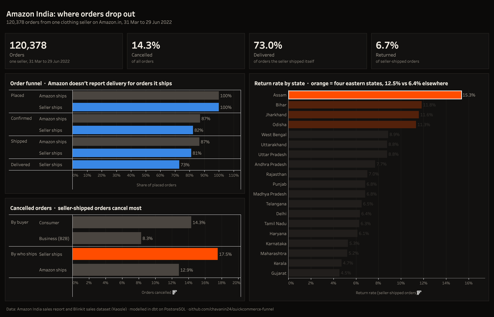
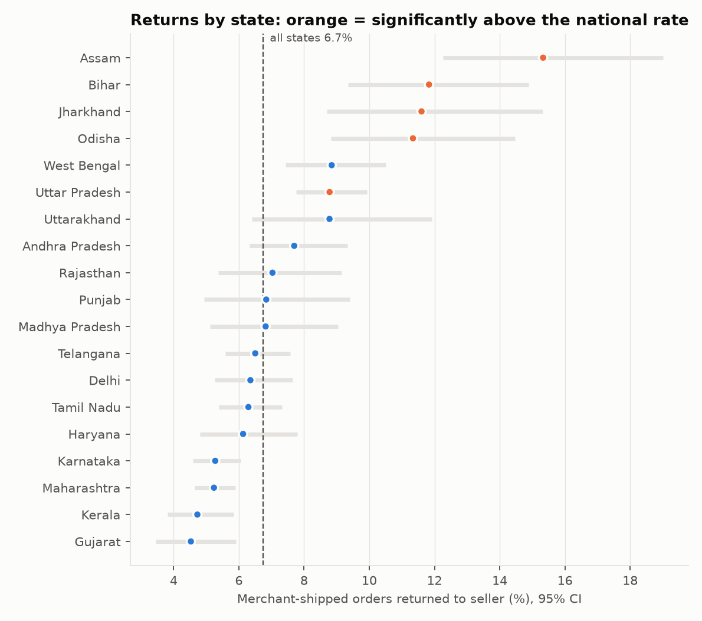
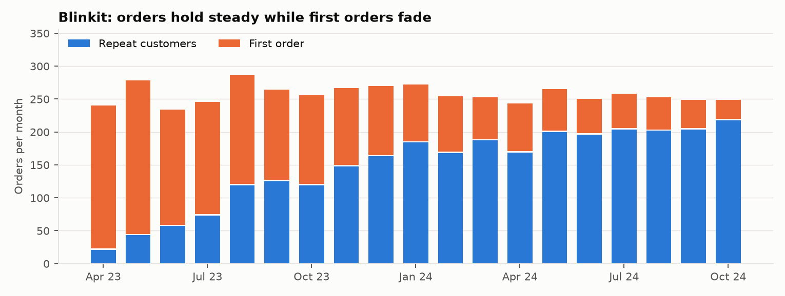
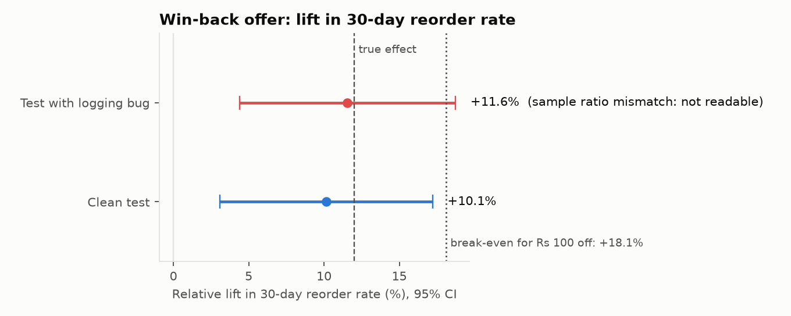
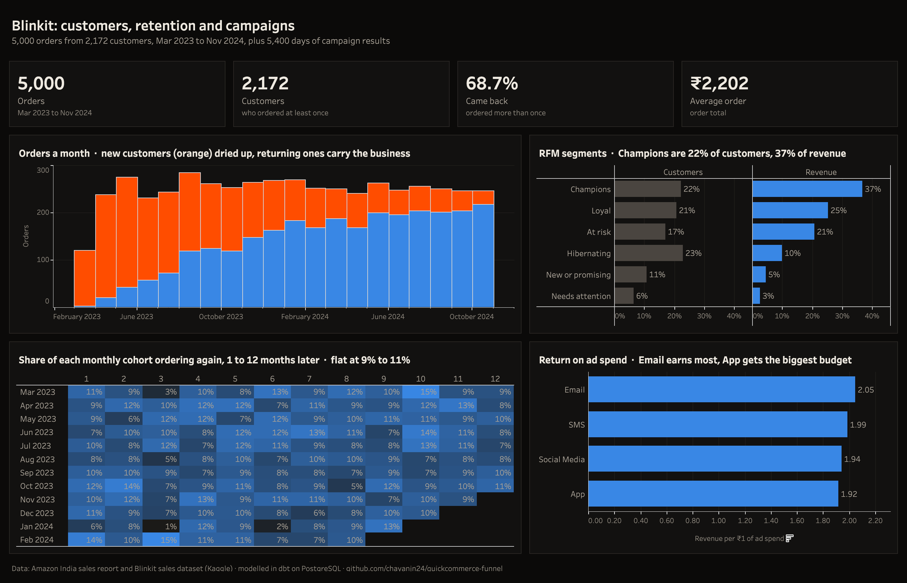
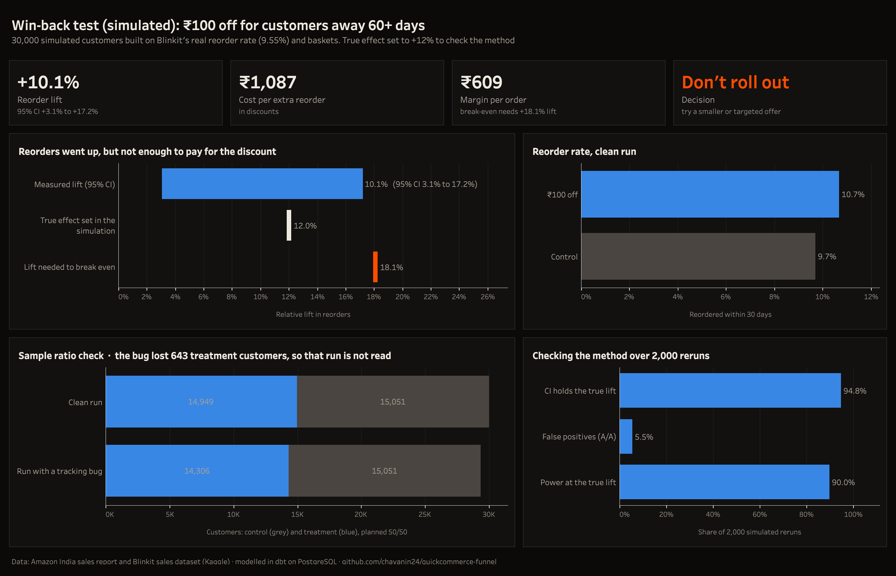
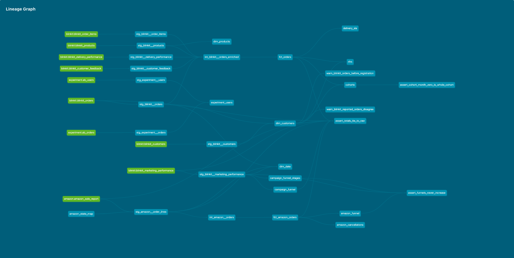

# Quick-Commerce Funnel

Where do online orders drop out, which customers come back, and does a discount bring lapsed customers back at a profit? I wanted Indian data for this, so I used two Kaggle datasets: Amazon India orders from one clothing seller, and Blinkit orders, customers and campaigns. I modelled both in Postgres with dbt, built dashboards in Tableau Public and Metabase on top, and analysed a win-back offer as an A/B test in Python.

**[Dashboard on Tableau Public](https://public.tableau.com/app/profile/chayan.gulgulia/viz/Quick-CommerceFunnel/AmazonIndia)** · **[Case study](https://chayangulgulia.vercel.app/work/quick-commerce)**



## Results

### Amazon India: where orders drop out

120,378 orders from one seller on Amazon.in, 31 Mar to 29 Jun 2022.

- **14.3% of orders were cancelled.** Orders the seller shipped itself were cancelled more often than ones Amazon shipped: 17.5% against 12.9%.
- **Only 73.0% of the seller's own orders reached the buyer.** 17.5% were cancelled and another 5.5% were shipped but came back. Amazon doesn't report delivery for the orders it ships, so this part of the funnel only exists for the seller's own orders.
- **Returns are highest in the East.** Assam, Bihar, Jharkhand and Odisha sent back 12.5% of shipments, against 6.4% for the rest of the country. Of the 19 states with 300+ shipments, these four and Uttar Pradesh are clearly above the 6.7% average, even after correcting for testing many states at once.
- **B2B orders were cancelled less:** 8.3% against 14.3%.
- **One column almost fooled me.** Orders with a promotion code look like they almost never get cancelled (0.4% against 36.1%). But the code is only added once an order goes through: none of the seller's cancelled orders have one, and 99.9% of delivered orders do. I left it out of the cancellation analysis.



### Blinkit: customers, campaigns and delivery

5,000 orders from 2,172 customers (Mar 2023 to Nov 2024), plus 5,400 days of campaign results.

- **Returning customers now carry the business.** Orders stayed at about 250 a month while new customers fell from 233 in May 2023 to 43 a month by mid-2024. In the last few weeks of data, 88% of orders came from returning customers.
- **People who come back keep coming back at the same rate.** In any month after their first order, 9% to 11% of a group orders again, and that holds out to month 12. The median gap between orders is 111 days.
- **A fifth of customers bring over a third of revenue.** In an RFM split, Champions are 22% of customers and 37% of revenue. The 371 At risk customers hold 21% of revenue, so they are the obvious group to win back.
- **The customer segments in the file don't match how people actually buy.** 113 customers labelled "Inactive" are Champions, so campaigns aimed at "Inactive" users reach the wrong people.
- **Email earns the most per rupee, but App gets the biggest budget.** Email brought ₹2.05 for every ₹1 spent, against ₹1.92 for App. The type of campaign and the audience made no real difference (all nine campaigns between ₹1.94 and ₹2.03).
- **Late deliveries didn't hurt ratings or repeat orders.** 69.4% of orders arrived on time and 9.9% were 16 to 30 minutes late. Both groups rated 3.33 on average and reordered at the same rate.



### Win-back test (simulated)

The offer: customers who haven't ordered for 60+ days get ₹100 off their next order. Blinkit's last month had only 1,642 such customers, which could only detect a 46% jump in reorders, so I simulated a test with 30,000. The starting reorder rate (9.55%) and the basket sizes come from the real Blinkit orders, and I set the true effect to +12% so I could check the analysis finds it.

- **Reorders went up 10.1%** (from 9.69% to 10.68%, 95% CI +3.1% to +17.2%). The true +12% is inside that range.
- **The offer doesn't pay for itself.** Each extra reorder cost ₹1,087 in discounts, because returning customers who would have come back anyway also get ₹100 off. An average order earns ₹609 in margin. Breaking even needs a lift of 18.1%, which is above the whole range. My call: don't roll out ₹100 off; try a smaller discount, or give it only to high-value At risk customers.
- **Revenue per customer can't settle it.** Most customers don't return, so the result swings from -6.3% to +9.7%. Pinning it down to ±2% would need 256,159 customers in each group.
- **The split check caught a planted bug.** In a second run, half the treatment users on an old app version lost their tracking. The groups came out 15,051 against 14,306, which the sample ratio check flags (p = 0.00001), so I didn't read that result. It showed +11.6%, too high.
- **The method holds up.** Over 2,000 reruns it gave a false positive 5.5% of the time (the target is 5%), caught the real effect 90% of the time, and its 95% range held the true effect in 94.8% of runs.



## Dashboards

**Tableau Public ([live](https://public.tableau.com/app/profile/chayan.gulgulia/viz/Quick-CommerceFunnel/AmazonIndia)):** three tabs, one for each part of the analysis: Amazon India, Blinkit customers and the win-back test. Every chart has hover details. It reads small extracts of the finished dbt tables.





**Metabase:** the working dashboard I used while building this, connected straight to Postgres. Four tabs: [Amazon India](images/dashboard_amazon.png), [Blinkit customers](images/dashboard_blinkit.png), [marketing and delivery](images/dashboard_marketing.png) and the [win-back test](images/dashboard_experiment.png). It reads through a read-only login that can see the finished tables but not the raw data. Metabase needs a server with about 1 GB of memory, so it runs locally and the screenshots are here instead.

## Data

- **Amazon:** `Amazon Sale Report.csv` from the [E-Commerce Sales Dataset](https://www.kaggle.com/datasets/thedevastator/unlock-profits-with-e-commerce-sales-data) on Kaggle, first shared by Anil Sharma on data.world. 128,975 order lines.
- **Blinkit:** the [Blinkit Sales Dataset](https://www.kaggle.com/datasets/akxiit/blinkit-sales-dataset) on Kaggle (MIT licence): orders, order items, customers, products, delivery, feedback and campaigns.
- Neither is stored here; `run.py` downloads both with the Kaggle API.

What I had to fix:

| Source | Problem | Fix |
|---|---|---|
| Amazon | 7 order lines appear twice | Kept one of each |
| Amazon | State names spelled several ways (RAJSHTHAN, ORISSA, RJ, NEW DELHI) | Mapping file in `dbt/seeds/` |
| Amazon | Promotion codes only on orders that went through | Left out of the cancellation analysis |
| Blinkit | Order count per customer wrong for 2,385 of 2,500 customers | Recounted from the orders table |
| Blinkit | 1,438 customers ordered before their registration date | Groups start at the first order instead |
| Blinkit | ROAS column doesn't equal revenue / spend on 5,374 of 5,400 rows | Recalculated |
| Blinkit | Order total isn't quantity × price on 4,993 of 5,000 orders | Used the order total as revenue |
| Blinkit | Customer names, emails and phone numbers in the file | Dropped when the data is first cleaned |

## How it works

1. **Load** ([`qcom/data.py`](qcom/data.py)): download from Kaggle and copy every CSV into Postgres as text, so a bad value fails a test instead of the load.
2. **Model in dbt** ([`dbt/`](dbt)): staging views clean each source table, two intermediate models join them to one row per order, and the marts hold the fact and dimension tables (`fct_orders`, `fct_amazon_orders`, `dim_customers`, `dim_products`, `dim_date`) plus the tables behind each finding: both funnels, monthly cohorts, RFM scores, delivery against promise and cancellations by state.
3. **Test** (58 dbt tests): keys, joins and allowed values, plus my own checks that totals add back up to the raw files, that no funnel stage is bigger than the one before it, and that every cohort starts at 100%. Two stay as warnings so the source problems above stay visible.
4. **Check each finding** ([`qcom/findings.py`](qcom/findings.py)): proportion tests, chi-square, Kruskal-Wallis and bootstrap ranges, with a Bonferroni correction where I compare many states.
5. **Win-back test** ([`qcom/experiment.py`](qcom/experiment.py)): sample size plan, sample ratio check, z-test with a confidence interval, bootstrap for revenue, and 2,000 reruns against the known answer.



## Run it

Needs Python 3.13, PostgreSQL and a [Kaggle API token](https://www.kaggle.com/settings) in `~/.kaggle`.

```bash
pip install -r requirements.txt
createdb qcom
python run.py            # download, load, dbt build and tests, win-back test, findings (about a minute)
python -m pytest
```

## Limitations

- The Amazon data is one seller over three months, so it says nothing about seasons or other sellers.
- Blinkit's 298,038 campaign conversions can't be linked to its 5,000 orders, so campaigns and customers are analysed separately, and ROAS uses the revenue the file reports.
- The win-back test is simulated. The starting rate and baskets are real, but the true effect, the smaller baskets and the tracking bug are my assumptions, so it shows the method rather than a real result.
- Margin comes from each product's margin percentage and ignores delivery cost, so the break-even point is rough.
